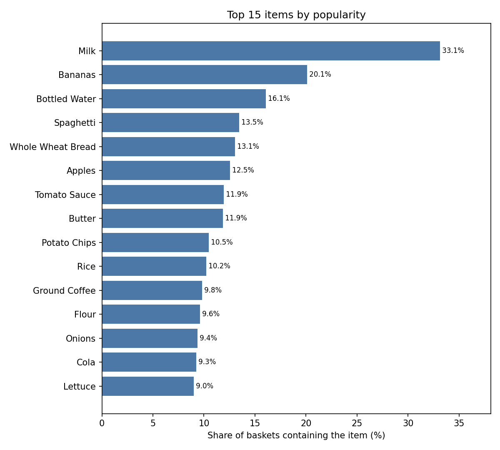
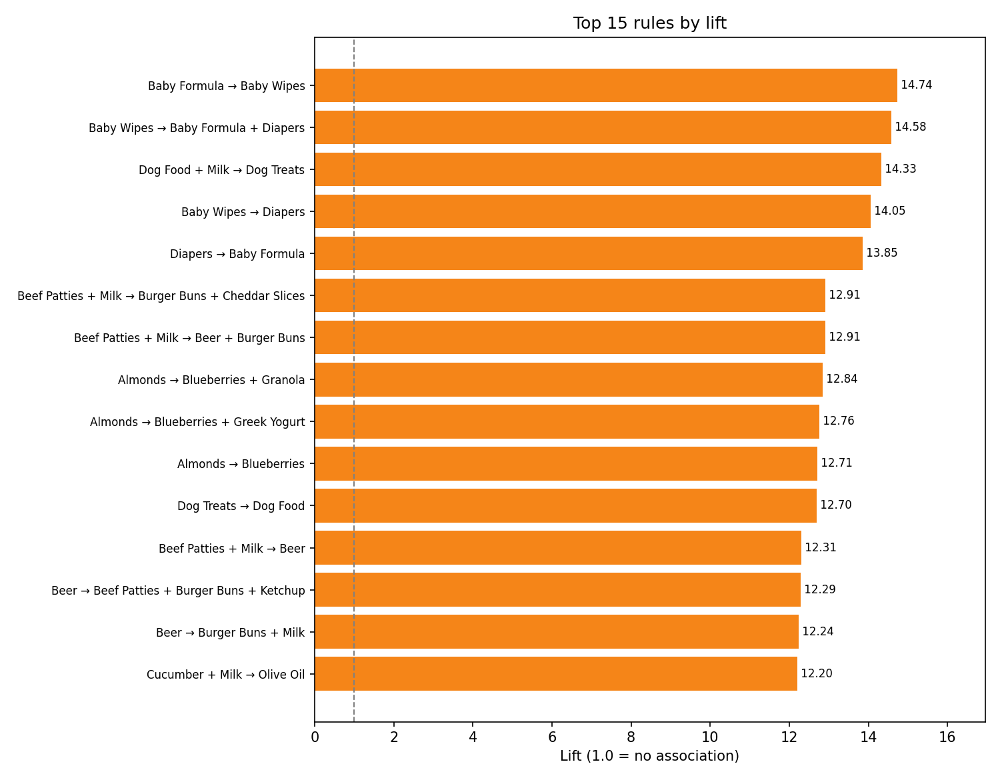
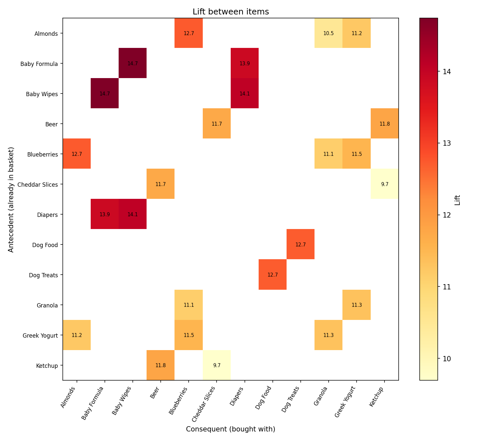
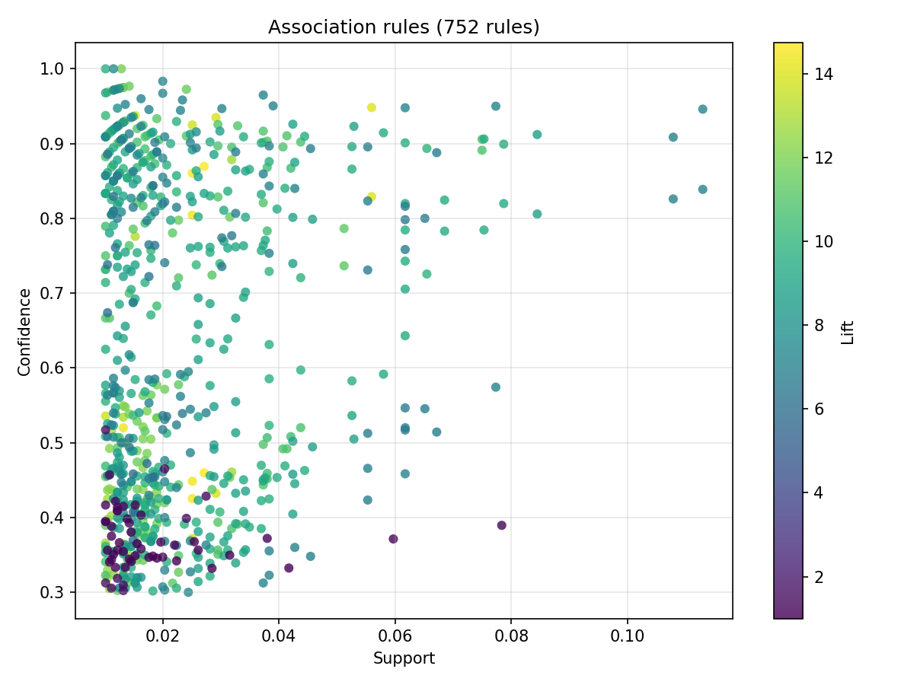

# Market Basket Analysis

Find out which products customers buy together. This project takes raw retail transactions, cleans them, mines frequent itemsets, generates association rules, visualizes the results and turns the rules into "customers also bought" recommendations.

It works on the public [Online Retail](https://archive.ics.uci.edu/dataset/352/online+retail) / [Online Retail II](https://archive.ics.uci.edu/dataset/502/online+retail+ii) datasets out of the box, and ships with a reproducible synthetic dataset so you can run everything immediately.

> Example finding: 95% of the baskets containing **Baby Wipes** also contain **Diapers**. Diapers appear in only 6.7% of baskets overall, so a basket with Baby Wipes is 14 times more likely to contain them (lift 14).

## What is market basket analysis?

Retailers record which items are bought in each transaction ("basket"). Market basket analysis looks for patterns such as *"customers who buy spaghetti usually buy tomato sauce too"*. Those patterns are written as **association rules**: `{spaghetti} -> {tomato sauce}`. Stores use them for shelf placement, bundles, promotions and recommendations.

Three numbers describe a rule `A -> C` (all measured over baskets):

| Metric | Meaning | Formula |
|---|---|---|
| **Support** | How common is the combination? | share of baskets containing A and C |
| **Confidence** | When A is bought, how often is C bought too? | support(A and C) / support(A) |
| **Lift** | How much more often than chance? `1` = no relationship, `>1` = bought together | confidence / support(C) |

Why lift matters: Milk is in 33% of all baskets in the sample data, so "X -> Milk" has high confidence for almost any X. Its lift stays near 1, which correctly says Milk is just popular, not related to X.

## Features

- **Robust cleaning**: removes cancelled invoices, returns, zero-price rows, postage/fee rows, missing values and duplicate items.
- **Flexible loading**: CSV or Excel (all sheets), column names auto-detected (Online Retail, Online Retail II, common aliases) or set explicitly.
- **FP-Growth or Apriori** mining (via [mlxtend](https://rasbt.github.io/mlxtend/)).
- **Rule metrics** computed in this repo: support, confidence, lift, leverage, conviction. Cross-checked against mlxtend in the tests.
- **Rule curation**: removes redundant rules and shows one rule per itemset so the headline list is readable.
- **Recommender**: "given this basket, what should we suggest?"
- **Charts and a Markdown report** written for every run.
- **CLI + Python API**, 73 tests, GitHub Actions CI.

## Quickstart

Requires Python 3.10+.

```bash
git clone <your-repo-url>
cd market-basket-analysis
python -m venv .venv && source .venv/bin/activate   # Windows: .venv\Scripts\activate
pip install -e ".[dev]"
```

Run the analysis on the included sample data:

```bash
marketbasket run --input data/sample_transactions.csv
```

```text
Baskets: 2,949 | items: 68 | frequent itemsets: 422 | rules: 752

Top 5 rules by lift (redundant rules removed):
  Baby Formula -> Baby Wipes  (support=0.027, confidence=0.87, lift=14.74)
  Baby Wipes -> Baby Formula + Diapers  (support=0.025, confidence=0.43, lift=14.58)
  Dog Food + Milk -> Dog Treats  (support=0.013, confidence=0.52, lift=14.33)
  Baby Wipes -> Diapers  (support=0.056, confidence=0.95, lift=14.05)
  Diapers -> Baby Formula  (support=0.029, confidence=0.43, lift=13.85)

Results written to outputs/
```

Ask for recommendations:

```bash
marketbasket recommend --item "Spaghetti" --item "Tomato Sauce"
```

```text
Basket: Spaghetti, Tomato Sauce
Recommended additions:
  Parmesan Cheese  (because of: Spaghetti; confidence=0.57, lift=7.06)
```

(`python -m marketbasket ...` works too.)

## Using your own data

Provide a file with **one row per item sold**, containing at least a basket/invoice id and an item name. Quantity and unit price columns are optional but used for cleaning when present.

```bash
# Online Retail / Online Retail II: columns are detected automatically
marketbasket run --input online_retail_II.xlsx --min-support 0.01

# Any other layout: name the columns
marketbasket run --input sales.csv --invoice-col order_id --item-col product_name
```

Column auto-detection recognises (case-insensitive): `InvoiceNo`, `Invoice`, `order_id`, `transaction_id`, `basket_id` for the basket; `Description`, `Item`, `Product`, `product_name` for the item; `Quantity`, `Qty`; `UnitPrice`, `Price`.

Notes:
- Excel files need `openpyxl` (installed by the `dev` extra, or `pip install openpyxl`). All sheets are read and combined.
- Cancelled invoices are recognised by the Online Retail convention (an id like `C536379`).
- Text files that are not UTF-8 fall back to Latin-1 automatically.
- The Online Retail datasets are not included. Download them from the links above (the UCI page offers a download button; Kaggle mirrors them as well).

## Command reference

`marketbasket run`

| Option | Default | Description |
|---|---|---|
| `--input` | required | CSV/XLSX of transactions |
| `--output-dir` | `outputs` | Where results are written |
| `--min-support` | `0.01` | Minimum share of baskets an itemset must appear in |
| `--min-confidence` | `0.3` | Minimum rule confidence |
| `--min-lift` | `1.0` | Minimum rule lift (try `1.5`-`2` for stronger rules) |
| `--max-len` | `4` | Largest itemset size to mine |
| `--algorithm` | `fpgrowth` | `fpgrowth` or `apriori` (same results; FP-Growth is usually faster) |
| `--min-basket-size` | `2` | Drop smaller baskets (single-item baskets cannot form rules) |
| `--invoice-col`, `--item-col`, `--quantity-col`, `--price-col` | auto | Column names if auto-detection fails |
| `--top-n` | `15` | Rows in the bar charts |

`marketbasket generate-data`: `--out`, `--n-transactions` (3000), `--seed` (42), `--no-noise`.

`marketbasket recommend`: `--rules` (default `outputs/rules.csv`), `--item` (repeat for several), `--top-n` (5).

### Choosing `min-support`

`min-support 0.01` means an itemset must appear in 1% of baskets. On big datasets with thousands of items, start higher (0.01 to 0.02) and lower it gradually: the number of itemsets grows quickly as support drops. On a 270,000-row test dataset (30,000 baskets, 3,000 items) the full pipeline ran in about 2 seconds at `min-support 0.005`.

## Output files

Each run writes to `--output-dir`:

| File | Contents |
|---|---|
| `rules.csv` | All rules with support, confidence, lift, leverage, conviction. Items in a rule are joined with ` \| `. |
| `frequent_itemsets.csv` | All frequent itemsets and their support |
| `summary.md` | Dataset stats, parameters, top rules ([example](docs/example_summary.md)) |
| `top_items.png` | Most popular items |
| `top_rules.png` | Highest-lift rules |
| `support_confidence.png` | Every rule as a point, colored by lift |
| `lift_heatmap.png` | Lift between pairs of items |

## Example results

Generated from `data/sample_transactions.csv` with default settings.

**Most popular items.** Milk, Bananas and Bottled Water are bought most often, but popularity is not association (see lift above).



**Strongest rules by lift.**



**Lift between item pairs.** Clusters show items bought for a shared purpose: baby care, healthy snacks, barbecue, pet care.



**All rules: support vs confidence, colored by lift.**



## Reading the results critically

The sample dataset is synthetic: it was generated from "shopping missions" (breakfast, pasta night, baby care, ...) plus random everyday items, so the algorithm is expected to rediscover those groupings, and it does. It also shows the pitfalls of rule mining:

- **Noise can look like signal at low support.** The top-rules table lists `Dog Food + Milk -> Dog Treats` (lift 14.3). Milk has nothing to do with Dog Treats: the simpler rule `Dog Food -> Dog Treats` (confidence 0.46) is the real pattern, and adding Milk raised confidence to 0.52 only by chance in a few dozen baskets. The redundancy filter removes rules when the extra item adds under 5 percentage points of confidence; this one cleared the bar by a small margin. Always compare a long rule with its shorter versions, and look at how many baskets support it.
- **High lift often comes with low support.** Rare items easily get extreme lift. Check support before acting on a rule.
- **Association is not causation.** A rule says items co-occur, not that one purchase drives the other.
- **Rules are not symmetric.** `Baby Formula -> Baby Wipes` has confidence 0.87, but `Baby Wipes -> Baby Formula` only 0.46, even though lift is identical in both directions.
- **Real data is messier.** Retail datasets have bundles, seasonal items and a long tail of rarely-sold products. Tune `min-support`, inspect the results and validate on a hold-out period before acting.

## How it works

```text
transactions file
      |  load_transactions    detect columns, read CSV/XLSX
      v
standardized rows (invoice, item, quantity, price)
      |  clean_transactions   drop cancellations, bad rows, non-products, duplicates, tiny baskets
      v
cleaned rows (invoice, item)
      |  build_baskets / encode_baskets    one-hot True/False matrix
      v
basket matrix
      |  mine_frequent_itemsets    FP-Growth or Apriori
      v
frequent itemsets
      |  generate_rules    split every itemset into antecedent/consequent, compute metrics, filter
      v
association rules  ---->  save CSV / plots / summary.md / recommend()
```

Design choices:

- **Rule metrics are computed in `marketbasket/rules.py`** instead of calling `mlxtend.association_rules`, whose signature has changed across mlxtend releases. `tests/test_rules.py` checks the results against mlxtend and against hand-computed values.
- **The item-support filter before mining is lossless.** Items below `min_support` cannot be in a frequent itemset, so they are dropped from the matrix, but every basket is kept so that support is still measured over all baskets.
- **Recommendations use only single-item-consequent rules.** The confidence of `A -> B + C` describes buying B *and* C, so it cannot be credited to B alone. Candidates are ranked by `confidence x lift`.
- **Output is deterministic**: ties in sorting are broken by item name.

## Python API

`examples/quickstart.py` (run it with `python examples/quickstart.py`):

```python
from marketbasket import (
    build_baskets, clean_transactions, encode_baskets,
    generate_rules, load_transactions, mine_frequent_itemsets, recommend,
)
from marketbasket.rules import rule_label, top_rules

raw = load_transactions("data/sample_transactions.csv")
clean = clean_transactions(raw, min_basket_size=2)

baskets = build_baskets(clean)
onehot = encode_baskets(baskets, min_item_support=0.01)

itemsets = mine_frequent_itemsets(onehot, min_support=0.01, max_len=3)
rules = generate_rules(itemsets, min_confidence=0.4, min_lift=2.0)

for rule in top_rules(rules, n=5).itertuples():
    print(rule_label(rule.antecedents, rule.consequents), round(rule.lift, 1))

print(recommend(rules, ["Spaghetti"], top_n=3))
```

Or run the whole pipeline in one call:

```python
from marketbasket import PipelineConfig, run_pipeline

result = run_pipeline(PipelineConfig(input_path="data/sample_transactions.csv", output_dir="outputs"))
print(result.stats)
print(result.rules.head())
```

## Project structure

```text
market-basket-analysis/
├── marketbasket/
│   ├── data.py          # load, clean, synthetic data generator
│   ├── preprocess.py    # baskets and one-hot encoding
│   ├── rules.py         # mining, rule metrics, pruning, CSV I/O
│   ├── recommend.py     # basket -> suggestions
│   ├── viz.py           # matplotlib charts
│   ├── report.py        # summary.md
│   ├── pipeline.py      # end-to-end run
│   └── cli.py           # `marketbasket` command
├── tests/               # pytest suite (73 tests)
├── examples/quickstart.py
├── data/sample_transactions.csv   # synthetic, 3,000 transactions
├── docs/                # images and example report used in this README
├── .github/workflows/ci.yml
└── pyproject.toml
```

## The sample dataset

`data/sample_transactions.csv` (14,252 rows) is generated by `marketbasket generate-data` with seed 42. It follows the Online Retail schema (`InvoiceNo, InvoiceDate, Description, Quantity, UnitPrice, CustomerID, Country`) and deliberately includes dirty rows that the cleaning step must handle: cancelled invoices with negative quantities, `POSTAGE` rows and missing descriptions. Regenerate it, or make a bigger one:

```bash
marketbasket generate-data --out data/big.csv --n-transactions 20000 --seed 1
```

Different NumPy versions can produce slightly different random streams, so a regenerated file may differ in detail from the committed one.

## Development

```bash
pip install -e ".[dev]"
pytest
```

The tests cover cleaning edge cases, hand-computed rule metrics, agreement with mlxtend, Apriori vs FP-Growth equivalence, recovery of the planted associations, recommender behavior, plots, the CLI and error handling. CI runs them on Python 3.10, 3.11 and 3.12 and smoke-tests the CLI.

## Ideas to extend it

- Filter by country or time period, or compare weekday vs weekend baskets.
- Weight itemsets by revenue (utility mining) instead of counts.
- Add a Streamlit app on top of `rules.csv`.
- Evaluate recommendations: mine rules on older baskets, then check how often they predict items in newer baskets.

## License

[MIT](LICENSE)
